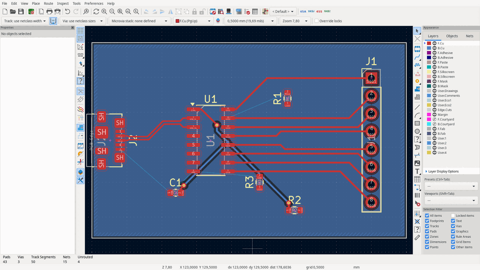

# Quick start: the push-and-shove router API

> **Кратко по-русски.** Это форк KiCad, в котором интерактивный трассировщик (push & shove)
> управляется через IPC API: агент или скрипт говорит «веди дорожку отсюда через эти точки», а
> геометрию, расталкивание соседей и соблюдение правил делает сам KiCad. pcbnew работает на
> виртуальном дисплее Xvfb, без окна на вашем экране. Ниже: запуск, первая дорожка, правила
> для агентов. Методика трассировки целой платы описана в [ROUTING_RECIPE.md](ROUTING_RECIPE.md).

This page gets you from a built fork to a routed track in a few minutes. The reference for
building, every API command and the tools is [../README.md](../README.md). How we route whole
boards with it is described in [ROUTING_RECIPE.md](ROUTING_RECIPE.md).



*The fork's pcbnew on its own Xvfb display (captured with `import -window root -display :9N`).
Nothing opens on your desktop. Every track on this board was placed through the API.*

## What you need

- A build of this branch (see "Building" in [../README.md](../README.md)). Only `pcbnew` is used.
  It runs from the build tree, so there is no install step.
- `Xvfb` and `xdotool` on the host.
- A Python with `protobuf` 5.29 and `pynng` for the client:

  ```bash
  python3 -m venv venv && venv/bin/pip install 'protobuf==5.29.*' pynng
  export KPNS_PY=$PWD/venv/bin/python
  ```

- Location variables, if your build or state directories are not the defaults: see
  `host/paths.sh` (`KPNS_BUILD`, `KPNS_STATE`, `KPNS_HOSTLIB`, `KPNS_SOCK_PREFIX`, ...).
- Optional, for the tools that edit stock KiCad files and for the grid router: a stock KiCad 10
  installation (`python3 -c 'import pcbnew'`, `kicad-cli`), and `numpy scipy shapely pillow`.

## For humans: five steps

**1. Start a headless instance** with your board and its project file:

```bash
ai-pns/host/hoststart_n.sh 1 board.kicad_pcb board.kicad_pro
# -> READY ipc:///tmp/kpns1/kicad/api.sock pid 12345
```

- The number (1 to 6) selects the instance. Each instance has its own Xvfb display `:9N`, socket,
  work directory and private KiCad config.
- The instance works on a **copy** of the board. A `board.kicad_dru` next to the `.kicad_pro` is
  copied along. Your file is never written.
- If the number is taken, the script answers `BUSY` and exits. It does not kill someone else's
  work unless you pass `--force`.

**2. Route a track** from Python:

```python
import sys; sys.path.insert(0, "ai-pns/pyapi")
import pns
from nk_base import bdt

c = pns.client_inst(1)            # instance 1
doc = pns.board_doc(c)
before = pns.snapshot(c, doc)     # all tracks, arcs and vias, for an undo

# start on a pad of the net; each point is a "click"; finish=True ends on the last point
r = pns.route_track(c, doc, (119.475, 110.825), [(127.0, 110.825), (140.0, 107.64)],
                    layer=bdt.BL_F_Cu, width=0.254, mode="shove", corner="mitered45", finish=True)
print(r.success, r.completed, r.message)
```

- Coordinates are millimetres in KiCad's own system: y grows downwards.
- `mode="shove"` pushes other tracks out of the way. `"walkaround"` goes around them and never
  moves anything.
- Add `point_layers=[...]` (one layer per point) to change layers. A layer change puts a via at the
  previous point. Pass `via_diameter`/`via_drill`, because the router does not take the via size
  from the netclass.
- A differential pair is one call with `diff_pair=True` (and optionally `gap=`). Start it on a pad
  of either net of the pair.

**3. Check it with DRC**, zones refilled:

```python
viol = pns.run_drc(c, doc, refill=True)
bad = [v for v in viol if v.type in ("clearance", "shorting_items", "tracks_crossing")]
if not r.success or bad:
    pns.rollback(c, doc, before)  # also restores neighbours a failed shove moved
```

**4. Save** a checkpoint. The fork writes the 10.99 file format:

```bash
$KPNS_PY ai-pns/tools/save.py ipc:///tmp/kpns1/kicad/api.sock checkpoint.kicad_pcb
```

Stock KiCad 10 cannot open that file. To get the copper into a 10.0 board, use
`tools/k10.py BASE10 checkpoint.kicad_pcb OUT10`. Its BASE10 is the same board saved by stock
KiCad, and it must already contain at least one track or zone. `tools/cdrc.sh` runs `k10.py` and
then stock `kicad-cli` DRC.

**5. Stop** the instance. Unsaved work is lost:

```bash
ai-pns/host/hoststop_n.sh 1 --xvfb
```

**To look at the display:** `import -window root -display :91 shot.png` (ImageMagick) or
`xwd -root -display :91`. Always name the display explicitly so the command does not run on your
desktop. The canvas repaints lazily after API edits: move the mouse over it
(`DISPLAY=:91 xdotool mousemove 1000 600`) before you capture.

## For AI agents: rules of the road

These rules come from several boards routed by agents with this fork. Each one is there because
ignoring it cost us a round.

1. **One instance per agent.** Use the instance number you were given. Never `--force` another
   instance, never kill a pcbnew you did not start, and never open a window on the user's display.
   The scripts unset `WAYLAND_DISPLAY` and use Xvfb. Keep it that way in your own commands too
   (`DISPLAY=:9N` explicitly; for GTK tools also `GDK_BACKEND=x11`).
2. **Project rules first.** Start the instance with the project's `.kicad_pro`, with its
   `.kicad_dru` next to it. With the wrong rules the router and DRC both work silently against
   the wrong numbers. See [ROUTING_RECIPE.md](ROUTING_RECIPE.md#1-rules-before-anything-else).
3. **Snapshot before every route, roll back on any doubt.** A failed shove attempt can leave
   neighbours moved even when nothing was committed for your net.
4. **Judge by geometry and DRC, not by the flags.**
   - `success`/`completed` can be True while the track stopped short of the end pad.
   - A net is done when `run_drc(nets=[net], refill=True)` has no `unconnected_items` and no
     `track_dangling` for it.
   - Compare violations against a baseline (`tools/baseline_drc.py --diff`). Do not expect zero on
     a board that already had violations.
5. **Lock what is not yours.** `tools/lock.py SOCKET --nets A,B` locks all other copper, so shove
   can only move your nets. When several agents share a board, `tools/merge.py` throws away any
   change you made to other nets.
6. **Write replayable scripts**, not interactive sessions. Each route should be a line in a script
   that can be re-run on a fresh copy of the start board. Checkpoint often with `save.py`.
7. **Never relax a rule silently.** If a net cannot be routed without a rule exception or a part
   move, stop and report it with coordinates.

A minimal agent loop with `tools/rt.py`, which routes, runs DRC and rolls back on regressions:

```python
import sys; sys.path.insert(0, "ai-pns/tools")
import rt
R = rt.R(1, flip_y=False)                 # instance 1, KiCad coordinates (the default is y-up!)
ok = R.go("SIG2", [(119.475, 110.825, "F"), (127.0, 110.825, "F"), (140.0, 107.64, "F")], w=0.254)
print(ok, R.open("SIG2"))                 # False = rolled back; open connections of the net
R.save("ckpt_01.kicad_pcb")
```

`R.go` routes in shove mode with mitered 45 degree corners, ends on the last point, and keeps the
result only if the net's open count dropped and no new copper violation appeared.

## The demo board

All screenshots in these docs come from a small synthetic board, generated from the standard
KiCad footprint library by [demo/make_demo.py](demo/make_demo.py). `demo/run_demo.sh` runs the
whole demo end to end:

- it builds the board;
- it pre-routes a bundle and a differential pair through the API;
- it plans A\* guides with the grid router;
- it routes them with the PNS router;
- it runs the gates and a shove example.

```bash
cc -O2 -shared -fPIC -o ai-pns/gridrouter/libastar.so ai-pns/gridrouter/astar.c -lm
DEMO_N=1 ai-pns/docs/demo/run_demo.sh /tmp/pns-demo    # DEMO_N: an instance nobody else uses
```

`demo/shot.sh` captures a cropped screenshot of an instance's display.

## Where next

- [ROUTING_RECIPE.md](ROUTING_RECIPE.md): the order we route a board in, how A\* paths are turned
  into clean PNS tracks, the per-round gates, how track widths are chosen, and the pitfalls.
- [../README.md](../README.md): building, the API commands, the full tool list, and router
  behaviour notes.
