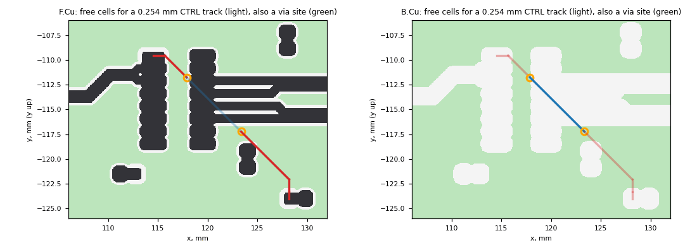
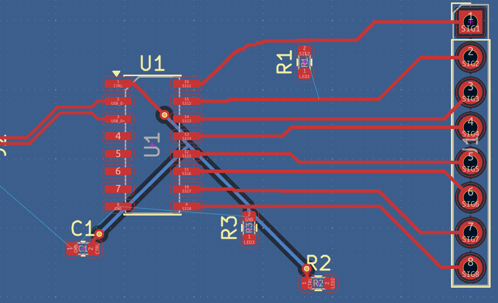
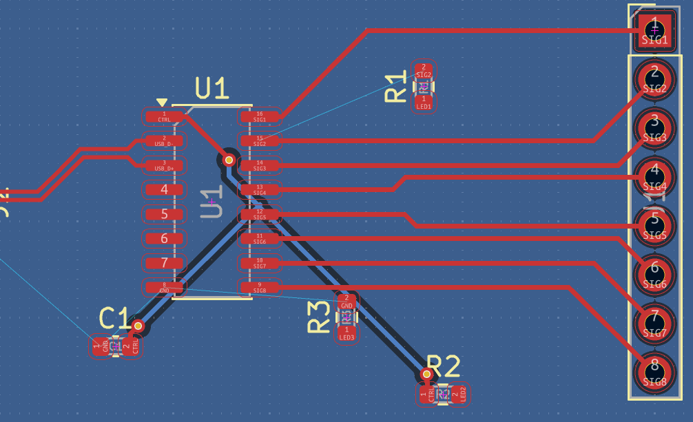
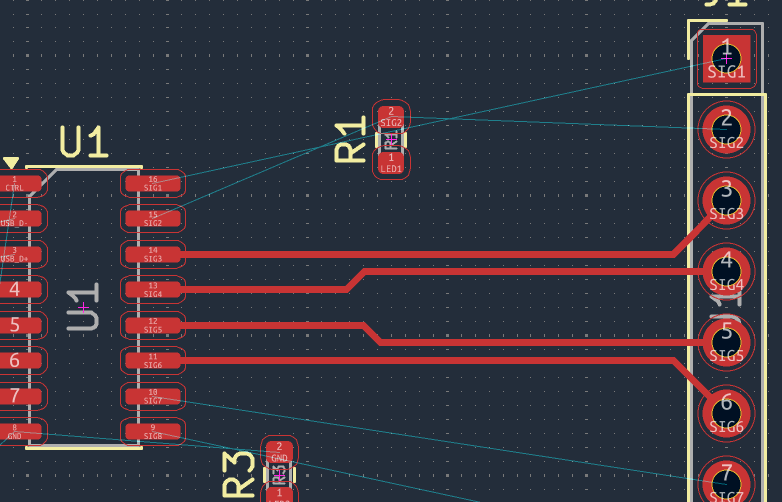
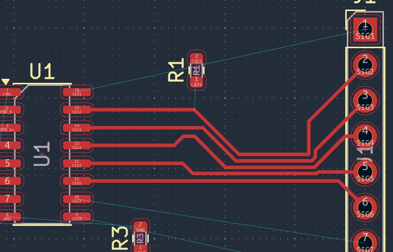
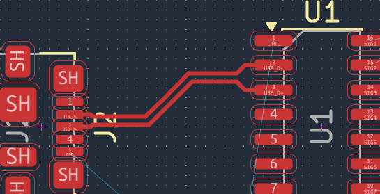
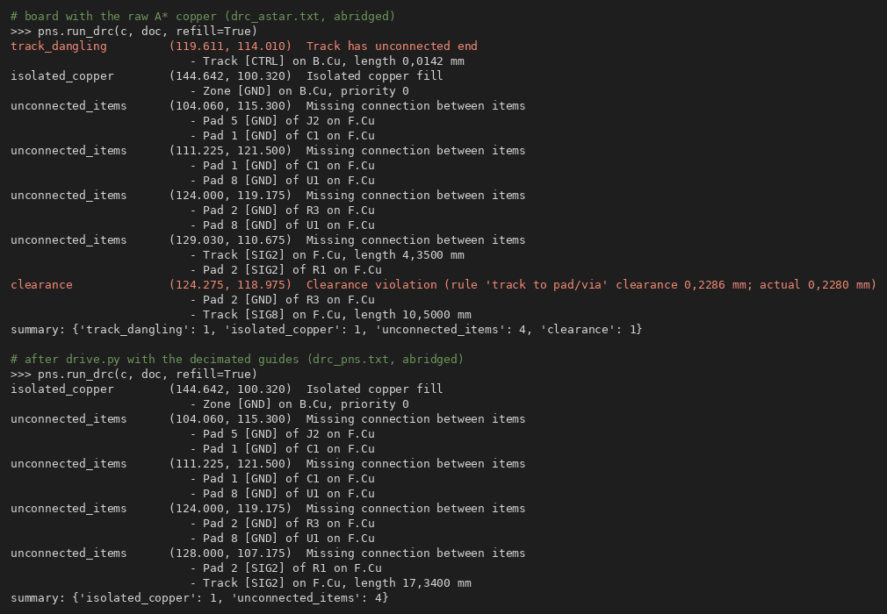

# How we route a board with the PNS router API

This is the method we converged on after routing several dense boards (4 and 6 layers, fine-pitch
modules, USB pairs, RF lines) with AI agents driving this fork. It is written for both the agents
and the people who brief them. The tools are in `ai-pns/tools/` and `ai-pns/gridrouter/`. The
start-up steps are in [QUICKSTART.md](QUICKSTART.md).

The screenshots and the numbers of section 7 come from a synthetic demo board; reproduce them with
`demo/run_demo.sh` (scripts in [demo/](demo/)). The other measurements quoted on this page come
from real boards we routed.

**Contents**

1. [Rules before anything else](#1-rules-before-anything-else)
2. [Frozen placement](#2-frozen-placement)
3. [Fan-out of the core parts](#3-fan-out-of-the-core-parts)
4. [Reserve ground and fence vias before signals](#4-reserve-ground-and-fence-vias-before-signals)
5. [Plan buses as bundles](#5-plan-buses-as-bundles)
6. [Parallel channel agents](#6-parallel-channel-agents)
7. [A\* for the path, PNS for the track](#7-a-for-the-path-pns-for-the-track)
8. [Gates, every round](#8-gates-every-round)
9. [Choosing track widths](#9-choosing-track-widths)
10. [Pitfalls we hit](#10-pitfalls-we-hit)

## The order, in one list

1. Project rules in `.kicad_pro` / `.kicad_dru`, checked by a small DRC test.
2. Placement frozen. Part moves only by explicit decision, recorded.
3. Core fan-out: escapes of the fine-pitch parts, on the pad axis, ending on pad centres.
4. GND vias, one per GND pad, and RF fence vias, all reserved before any signal.
5. Buses planned as bundles on an inner layer, at most 2 vias per net.
6. Remaining nets routed in parallel by channel agents, each in its own instance, with lock and
   merge.
7. A\* grid router only for the path. The track is made by the PNS router from the A\* guide,
   followed by a cleanup.
8. Gates after every round: DRC with zones refilled, against a baseline; `fancheck.py`; the
   target format's DRC if the board is exported.

## 1. Rules before anything else

Put the real rules into the project **before the first track**: netclasses with track width,
clearance and via size; board minimums; custom rules in `.kicad_dru`. Start every instance with
that `.kicad_pro`; `host/hoststart_n.sh` copies the `.kicad_dru` that sits next to it.

Wrong project rules do not produce errors. They silently move the goal posts:

- **Without the custom rules the router refuses things that are legal.** In one board without the
  `.kicad_dru`, even the first click failed (`The routing start point violates DRC`), because a
  module's pads were closer together than the netclass clearance. Only the neck rule (section 9)
  made the escape legal.
- **With rules that are too loose, DRC passes copper that the house standard forbids.** Nothing
  tells you, until review.
- **The router does not use the netclass via size.** It places 0.7/0.3 vias unless you pass
  `via_diameter`/`via_drill`. A custom rule catches a miss (`examples/rules.example.kicad_dru`,
  "power via").
- **Zone settings change connectivity.** On one board, the GND pour's clearance of 0.4064 mm
  instead of 0.2286 mm left 42 instead of 33 connections open, because the pour no longer reached
  the pads.
- **Library footprints may violate your clearances by themselves.** On the demo board, the
  micro-USB connector's pads are 0.20 mm apart against a 0.2032 mm netclass clearance. A one-line
  rule for that footprint (`demo/demo.kicad_dru`) keeps the baseline clean, so later DRC runs show
  only real problems.

Test the rules once with a few deliberate tracks before routing. We route a track that must pass,
one that must fail, and one at the edge of each custom rule, and check the DRC verdict for each.
`RunDrc` reports the rule in `description`; the `rule` field can read `Local override` for
everything.

## 2. Frozen placement

Route on a fixed placement. A part move invalidates checkpoints, merges and baselines.

- Agree beforehand which parts may move and by how much, for example "small passives up to 2 mm,
  no connectors, no modules". Every move is recorded (ref, old and new position and rotation,
  side) so it can be synced back to the schematic, the 3D model or the source CAD.
- The fork's helpers do not move footprints. Save the board, change the position in the file (or
  with stock pcbnew on a copy) and reload.
- When the router keeps failing in one area, the cause is usually placement: a part that leaves no
  via site, or a connector whose pin order is the reverse of the bus. Report it with coordinates
  instead of forcing a route.

## 3. Fan-out of the core parts

Route the escapes of the fine-pitch parts first, by hand-written script, before anything else
takes their space.

- **Leave a pad along its axis.** For an elongated pad, the track exits through the pad's short
  end, along the long axis, and only then turns. It never runs into the gap between two
  neighbouring pads, and never snaps to a routing grid if that puts it into the gap. A track
  alongside a pad row must stay within the pad's width.
- **End on the pad centre.** Some downstream tools, EAGLE among them, count a track as connected
  only at the pad origin.
- **One via per escape**, in the strip just outside the part, placed together for all pins of
  that side. Choose the via positions jointly, not net by net. We searched over orders and
  placements for a strip of six escapes, because a greedy first via took the only legal site of
  a later net.
- **Fine pitch needs a neck.** See [Necks](#necks-a-local-exception) in section 9.

`tools/fancheck.py` checks the three geometric rules on a stock 10.0 copy: 45 degree angles,
ends on pad centres, and pad exits along the axis.

## 4. Reserve ground and fence vias before signals

**This was our biggest lesson.** On one 4-layer board, we routed all signals first and left GND to
"stitch later". After that, most of the board had no legal via site left:

- a via must keep 0.2286 mm to any SMD pad, the GND pads included;
- the copper was dense.

In a typical 8 x 8 mm window around a stranded GND pad, the grid router found 0 to 20 legal via
cells. 36 GND pads stayed unconnected. Local rip-up around each pad (±2 to 3 mm) fixed only a
handful, so the board went to 6 layers.

Reserve these before routing signals:

- **A GND via for every GND pad**, each with an on-axis stub, placed as close as the rules allow.
  On the 6-layer redo, the reservation pass placed 79 of 85 at once. The 6 failures were visible
  and could be planned for, instead of being discovered at the end.
- **RF fence vias** along the RF lines, at the planned pitch (we used 2 mm), on both sides.
- **Via sites under parts that allow them**, for example tented vias under a module body.

Verify a "no legal site" verdict with a large window. One of our tools padded small search
windows with "outside the board", so every cell looked too close to an edge. "No room for a fence
via" turned out to be a tool artefact.

## 5. Plan buses as bundles

Long buses get a planned corridor, not a net-by-net search:

- **One inner layer per bundle**, lanes at a fixed pitch (track plus clearance, for example
  0.254 + 0.2032 = 0.457 mm), with a via row at each end.
- **At most 2 vias per net:** one where the lane leaves the source part's fan-out, one at the
  destination.
- **Lane order matches the destination's pin order.** Where the source part allows it, swap
  GPIOs in the schematic so that the bundle does not have to cross itself. Check the datasheet
  first. Some functions are fixed to pins, for example a hardware SPI. Others are free, for
  example a bit-banged I2C. Record every swap for the schematic.
- **Measure the corridor before routing.** We rasterised the free space and computed the widest
  corridor between source and destination. 8 lanes needed 3.45 mm. The corridor was 3.98 mm
  before the GND reservations and 3.50 mm after, which is a tie, so the plan changed (another
  layer) before any routing time was spent.

## 6. Parallel channel agents

Several agents can route disjoint net groups of one board at the same time:

1. The integrator prepares a common start board. It opens the board in the fork once and saves
   it with `save.py`, because `merge.py` needs the same file version for the base and the parts.
   It also dumps a DRC baseline: `tools/baseline_drc.py SOCKET baseline.tsv --refill`.
2. Each agent gets:
   - a net list;
   - an instance number;
   - the brief: rules, keep-outs, which areas and layers are its channel.
3. The agent:
   - copies the base and starts its instance;
   - runs `tools/lock.py SOCKET --nets <own nets>` **first**, so that shove can only move its own
     copper;
   - routes with a replayable script, checks against the baseline, and checkpoints with
     `save.py`.
4. The agent delivers:
   - `part.kicad_pcb`;
   - the exact net list it owns;
   - a log of what is routed, what is open and why, with coordinates.
5. The integrator runs `tools/merge.py BASE OUT part1:NETS part2:NETS ...`. It replaces all copper
   of each listed net with the part's copy. Changes to other nets are reported as `FOREIGN` and
   discarded, and copper too close to another net is reported as `CONFLICT`. Then it loads OUT
   and runs DRC against the baseline.

What we learned:

- **Owning a net means owning all of its copper,** leftovers from an earlier pass included.
- **Do not unlock foreign nets to get through.** The merge discards your shove, and your route then
  collides with the original copper.
- **Locked channels get stuck at the borders.** Each agent sees the others' copper as fixed walls.
  We always needed one final "finisher" with all nets unlocked and a global view, who could
  re-plan a whole strip (for example re-route a bus so that it enters a connector from the other
  side) and move small parts within agreed limits.

## 7. A\* for the path, PNS for the track

**Prefer the PNS router.** Use the grid A\* router (`gridrouter/`) only to find a path that the
PNS router then follows, or as a last fallback.

The reason: a board we finished with a grid A\* router and a negotiated-congestion router was
DRC-clean but looked autorouted. It had long detours, 4 to 6 vias on bus nets, and micro-jogs.
It needed several post-processing passes, and the cosmetic pass was still left to a human. The
PNS router makes tracks a person would draw: 45 degree postures, hugging at exact clearance, and
shoving neighbours instead of detouring around them.

### The A\* guide

`gridrouter/fr.py` routes on a stock 10.0 copy of the board.

- **Obstacles.** It rasterises all copper (0.025 mm grid by default) into "free for a track of
  width w" maps per layer, plus a "legal via site" map. Rule areas, inter-pad gaps and configured
  keep-outs are forbidden.
- **Cost.** A\* searches with exact 45 degree moves. Each leg is charged a turn cost (`turn45`,
  `turn90`) and a via cost (`viacost`).
- **Terminals.** `lib2.task()` / `lib2.connect()` add on-axis pad stubs and route between the
  islands of a net.



*The grid router's view of net CTRL on the demo board (`demo/plot_astar.py`). Light cells are
free for a 0.254 mm track, green cells are also legal via sites, dark cells are blocked. The path
leaves U1.1 east on F.Cu, drops a via between the pad rows, crosses under the bundle on B.Cu,
comes back up beside R3 and runs on F.Cu to R2. The A\* sees every other track as a fixed wall.
This path was planned alone with the default costs, so it differs from the CTRL route in the
images below.*

### From the A\* polyline to a PNS track

1. **Plan.** Run A\* for the nets on a stock 10.0 copy. Get it from the fork with `save.py`
   followed by `k10.py`. Commit each path in the planning copy (`commit=True`), so that the next
   net avoids it.
2. **Convert** each path to a `tools/drive.py` guide. `fr.py` uses y-up coordinates and layer
   letters; `drive.py` uses KiCad's y-down coordinates and indices into `--layers`:

   ```python
   LI = {'F': 0, 'B': 1}                       # order of --layers F.Cu,B.Cu
   p = lib2.task(B, net, pad=('U1', '16'), to_pad=('J1', '1'), commit=True, layers='F')
   guide = {'net': net, 'w': 0.254,
            'a': [p[0][0], -p[0][1]], 'la': LI[p[0][2]],        # start anchor: pad centre
            'b': [p[-1][0], -p[-1][1]], 'lb': LI[p[-1][2]],     # end anchor
            'pts': [[x, -y, LI[L]] for x, y, L in p[1:-1]]}
   ```

   The full version is [demo/plan_astar.py](demo/plan_astar.py).
3. **Decimate the guide.** Keep the anchors, the pad stub ends (on-axis exits), and both ends of
   every layer change (the vias). Drop all other vertices ([demo/decimate.py](demo/decimate.py)).
   - With every A\* vertex as a click, `RouteTrack` reproduces the A\* polyline, grid jogs included.
     It only fixes clearance where the raster was marginal.
   - With the decimated guide, the router chooses its own posture between the kept points.
   - Without the stub ends, it happily leaves a pad diagonally, which breaks the fan-out rule.
4. **Route** with `tools/drive.py GUIDES.json --socket S --layers F.Cu,B.Cu`. For each guide it:
   - snapshots the board;
   - calls `RouteTrack` in shove mode with mitered 45 degree corners, finishing on the end anchor;
   - accepts the result only if the net's open count dropped and the board's copper violations did
     not grow (after a zone refill);
   - otherwise rolls back, shoved neighbours included, and retries in walkaround mode;
   - with `--rip`, if both modes fail and the guide lists blocking segments of other nets, deletes
     those and retries once. Protect what must not be ripped with `--no-rip`.
5. **Fallback 1: the full guide.** Run `drive.py` again with the undecimated guides. It skips nets
   that are already connected, so only the failures are retried, now with every A\* corner as a
   click.
6. **Cleanup** with `pns.cleanup_tracks(c, doc, nets=[...], merge=True, dangling=True,
   redundant_vias=True, dangling_vias=True)`. This merges collinear segments and deletes dangling
   stubs and redundant vias. **Always pass your nets**; without `nets` it edits every net on the
   board.
7. **Re-route detours and drop superfluous vias.** Find the nets that are much longer than their
   pad-to-pad distance or have more vias than layer changes require.
   - For each one: snapshot, delete its copper (`rt.delete_where`), and route again with
     `RouteTrack` from the anchors only, or with one or two hand-picked corner points, preferably
     on a single layer.
   - Keep the new route if DRC is not worse and length or via count dropped; otherwise roll back.
   - For one detour segment, `DragTrack` can pull it straight. Check the geometry afterwards: seen
     once on the demo board, a drag reported `success` and `end == target`, yet the segment ended 1.3 mm short and
     the shove re-shaped a neighbour.
8. **Fallback 2: commit the A\* copper** (`fr.Brd.commit`) only for a connection the PNS router
   cannot make at all. Then run the gates especially carefully (see below).

### The demo, in numbers

The A\* below was run with zero turn cost and a via cost of 8 (defaults: `turn45=1`,
`turn90=8`, `viacost=40`) to make the grid artefacts obvious. With the default costs the paths
are cleaner, but the mechanics are the same.

| | raw A\* copper | PNS from the decimated guides |
|---|---|---|
| SIG1 segments (shorter than 0.1 mm) | 25 (9) | 3 (0) |
| SIG2 / SIG7 / SIG8 segments | 10 / 10 / 7 | 2 / 2 / 4 |
| CTRL segments, vias | 20, 3 | 13, 3 |
| clearance violations | 1 (0.2280 mm against 0.2286 mm: raster rounding) | 0 |
| dangling track | 1 (0.014 mm stub where two legs meet) | 0 |
| `fancheck.py` non-45 segments | 1 | 0 |

Lengths were the same to 0.1 mm; the gain is in geometry and DRC, not length. On a dense board
the gain is larger, because shove lets the PNS track take a corridor that A\* saw as blocked.



*Before: the A\* paths committed as they are. SIG1 runs in a staircase of 45 degree micro-jogs, and
SIG2 and SIG7 have 0.025 mm grid offsets. The GND pour on B.Cu is shown filled.*



*After: `drive.py` with the decimated guides. Each SIG net is an on-axis stub plus one 45 degree
posture into the header. CTRL keeps its vias (two on the U1 to R2 leg, one on the C1 leg),
because the bundle and the USB pair leave no single-layer path.*

### Shove in action




*`demo/shove_demo.py` routes SIG2 from U1.15 to J1.2 with a corner point inside the
SIG3 to SIG6 bundle. In shove mode the router pushes all four tracks down. The call created 23 and
removed 8 items, mostly the neighbours' re-shaped segments, and DRC stayed clean. In walkaround
mode the same call fails with `could not reach point 1`, and on another board a locked bundle
stopped the router in the same way.*

### A differential pair



*One `RouteTrack` call with `diff_pair=True, width=0.2032, gap=0.2032`, started on the D+ pad of J2
and ended on the D+ pad of U1. The router found the partner net by name (`USB_D+` / `USB_D-`),
coupled the pair and split it at both ends to reach the pads. The tracks started about 0.3 mm from
the connector pad's centre, inside the pad. If your rules want ends on pad centres, add a stub and
let `fancheck.py` confirm it.*

## 8. Gates, every round

After every routing round, whether an agent's part, a merge or a cleanup pass, run all of the
following. A round that fails a gate is rolled back, not patched.

1. **DRC with zones refilled**, compared against the baseline:
   - `pns.run_drc(c, doc, refill=True)` in the fork;
   - `tools/baseline_drc.py SOCKET --refill --diff baseline.tsv` for new violations only;
   - `tools/cdrc.sh FORK.kicad_pcb TAG BASE10.kicad_pcb` for stock `kicad-cli` DRC on a 10.0 copy.
     It is our reference count for unconnected items, because the fork's own unconnected count
     was not reliable after deletes.

   Without `refill`, DRC checks stale zone fills and misses both shorts to the pour and
   connections it would make.
2. **Geometry:** `tools/fancheck.py BOARD10`. It checks 45 degree angles only, ends on pad
   centres, and pad exits along the pad axis. Also check by your own script the house rules that
   DRC cannot express, for example "no via within the module outline" or "never route on the
   plane layer".
3. **Untouched nets untouched:** diff the copper of nets this round did not own against the
   round's start. Cleanup passes on "all nets" silently merged, split or trimmed segments of
   other nets. We restored them from the start board.
4. **Target-format DRC** if the board goes back to another tool (for example EAGLE). Run that
   tool's own DRC on the exported board. Ends off pad centres and different clearance semantics
   show up only there.
5. **Images:** a plot of the changed area, for the log and for the reviewer.



*`demo/drc_list.py` on the demo board, before and after the PNS pass (abridged: the silkscreen
warnings of the USB connector are left out). The "isolated copper fill"
is a corner of the GND pour cut off by tracks. The open connections are expected: GND is not
routed in the demo, and SIG2's branch to R1 is not in the guides.*

## 9. Choosing track widths

Our house rules are given here as an example ruleset. Use your own numbers, but decide them all
before routing (section 1).

| item | example value |
|---|---|
| clearance track to track | 0.2032 mm (8 mil) |
| clearance track to pad or via | 0.2286 mm (9 mil) |
| clearance copper to board edge | 0.254 mm (10 mil) |
| signal track, default | 0.254 mm |
| signal track, minimum where needed | 0.2032 mm |
| power track, minimum | 0.4064 mm; 0.6 to 1.0 mm for real current paths |
| via | 0.7 mm pad / 0.3 mm drill; 0.8/0.4 for power nets other than GND |
| via to any SMD pad, same net included | 0.2286 mm; no via in or over a pad |

### Signals: default and minimum

Route signals at the default width. Drop to the minimum only where a corridor or a pad pitch
needs it, and only for that stretch. The default is the width that the fab yield, the etch
tolerance and later rework are happy with. The minimum is a local exception, and it should
appear in the routing log.

### Power: width by current

The classic sizing is the IPC-2221 curve fit:

    I = k * dT^0.44 * A^0.725
    I in A, dT = allowed temperature rise in K, A = copper cross-section in mil^2
    k = 0.048 for outer layers, 0.024 for inner layers

    width = A / thickness;  1 oz copper = 35 um = 1.378 mil

Worked example, 1 A on an outer 1 oz layer with a 10 K rise:

    A = (1 / (0.048 * 10^0.44))^(1/0.725) = (1 / 0.1322)^1.379 = 16.3 mil^2
    width = 16.3 / 1.378 = 11.8 mil = 0.30 mm

The same fit for other cases (`demo/widths.py`):

| current, dT = 10 K | outer, 1 oz | inner, 1 oz | inner, 0.5 oz |
|---|---|---|---|
| 0.5 A | 0.12 mm | 0.30 mm | 0.60 mm |
| 1 A | 0.30 mm | 0.78 mm | 1.56 mm |
| 2 A | 0.78 mm | 2.03 mm | 4.07 mm |
| 3 A | 1.37 mm | 3.56 mm | 7.11 mm |

- IPC-2221 is conservative, especially for inner layers.
- **IPC-2152** replaced it with charts based on newer measurements. Those give inner tracks that
  are much closer to outer ones, because heat spreads into the planes. Use the IPC-2152 charts,
  or a calculator built on them, when the IPC-2221 inner width does not fit. Do not apply the
  formula above with an "IPC-2152" label.
- **Check the copper weight of each layer** with the fab. Inner layers of standard multilayer
  stack-ups are often 0.5 oz while the outer layers are 1 oz, which doubles the inner width.
- Keep the house minimum (0.4064 mm here) for every power net even at milliamps, for voltage drop
  and robustness. Widen the real current paths (input, switcher loops, regulator outputs to their
  loads) by the table.
- Vias carry current too. Several vias in parallel where a wide track changes layer.

### Impedance-controlled lines: width from the stack-up

For RF and high-speed pairs the width follows from the stack-up, not from the current:

1. Get the fab's stack-up: dielectric thickness h between the track and its reference plane,
   relative permittivity er, copper thickness t.
2. Compute the width for the target impedance. `demo/widths.py` uses Hammerstad-Jensen for a
   surface microstrip with a thickness correction. For an edge-coupled pair it uses the IPC-2141A
   approximation `Zdiff = 2 * Z0 * (1 - 0.48 * exp(-0.96 * s / h))`.
3. Confirm with the fab's impedance calculator or a field solver, and order impedance control if
   the tolerance matters.

Worked example: a standard 6-layer 1.6 mm stack-up (JLCPCB JLC06161H-3313, values as published
at the time of writing). The outer layers sit on 3313 prepreg to a GND plane on the next layer:
h = 0.0994 mm, er = 4.1, t = 0.035 mm.

| line | result of `widths.py` | what we used |
|---|---|---|
| 50 ohm microstrip | w 0.17 mm: 50.8 ohm; w 0.18 mm: 49.3 ohm | 0.17 mm |
| 90 ohm USB pair | w 0.18 / s 0.20 mm: 91.9 ohm; w 0.2032 / s 0.254 mm: 88.3 ohm | 0.2032 / 0.254 mm |

Notes:

- Solder mask lowers these values by roughly 1 to 3 ohm. It is not included.
- The reference plane must be continuous under the whole line: no splits, no slots, no via
  fields cut through it. A signal layer whose nearest plane is far away (for example an inner
  layer pair between two thick cores) needs its own calculation, or the line moves to a layer
  next to a plane.
- **Coplanar waveguide (CPWG).** With a grounded pour beside the line, the impedance also
  depends on the gap to the pour. `widths.py` has no model for that. If the pour comes closer
  than about 2 to 3 h, size the line with a field solver or the fab's calculator, and keep the
  pour gap as a rule (a netclass clearance or a custom rule), so the router keeps it too.
- Give the pair a netclass with `diff_pair_width` and `diff_pair_gap`, and pass the same numbers
  to `RouteTrack` (`width=`, `gap=`). Match lengths with the tuning patterns
  (`nk_base.tuning_pattern`).

### Necks: a local exception

A fine-pitch part sometimes cannot be escaped at the default width or clearance. Allow a local
neck through a rule area, by exception only, and document it:

- Draw a rule area (keep-out off, named for example `U1_NECK`) around the part's pads plus about
  0.6 mm.
- In `.kicad_dru`, allow a narrower track and a smaller clearance only for items that touch the
  area. See `examples/rules.example.kicad_dru`: 0.17 mm track and 0.2286 mm clearance inside the
  area, 0.254 mm minimum width everywhere else.
- **The relaxed values apply to a whole segment** that merely touches the area, and the router
  applies the relaxed clearance to every segment of a `RouteTrack` call that touches it. Route the
  neck in its own call that ends about 0.3 mm outside the area, at least the wide track's
  half-width plus a margin. Start the full-width call there.
- Measured on one board: a neck that ended 0.05 mm outside the area let the following 4.6 mm
  full-width run be shoved against a neighbour at the relaxed clearance, and DRC flagged it. A
  neck ending 0.25 mm outside kept the full clearance.
- Test both sides of the rule with DRC, as in section 1: a narrow track inside passes, the same
  track outside fails.

### Clearances

- Use one track-to-track clearance and a slightly larger track-to-pad/via clearance. The latter
  covers pad etch and solder mask tolerances.
- Copper to board edge must also cover the routing tolerance of the outline; panel tabs may need
  more.
- Pour clearance (zone to other nets) is a separate decision. A larger value gives fewer slivers
  but reaches fewer pads (section 1). Island removal set to "always" deletes pour islands that
  have no via. Expect `isolated_copper` and plan stitching vias for the islands you need.

### Via size against routing capacity

A via costs routing space on every layer it passes through:

- **Blocked corridor.** With a 0.7 mm via, a 0.254 mm track and 0.2286 mm track-to-via clearance,
  no track centre may come closer than 0.35 + 0.2286 + 0.127 = 0.706 mm to the via centre. The via
  blocks a 1.41 mm wide corridor, about 3 track pitches (0.457 mm) on every layer.
- **Smaller vias** (0.6/0.3: 1.31 mm; 0.45/0.2: 1.16 mm) buy capacity at the cost of fab class,
  price and current.
- **Via-to-SMD-pad clearance** decides where vias can go at all. With 0.2286 mm to any pad, a
  0.7 mm via needs a 1.16 mm free circle around its centre, clear of every pad. Between the rows
  of a dense part, that is often nowhere. Map the legal via sites before planning fan-out and GND
  (sections 3 and 4).
- **Between pins.** With 0.254 mm tracks and 0.2286 mm to pads, a track between two pads needs a
  0.711 mm gap:
  - 2.54 mm headers with 1.7 mm pads (gap 0.84 mm) take one track between pins;
  - 1.27 mm SOIC pads (gap 0.67 mm) take none, and the fan-out rule forbids it anyway.

## 10. Pitfalls we hit

- **A SWIG `Remove()` corrupts later work in the same process.** With stock pcbnew's Python, after
  removing items from a board or footprint, later `Add()` calls or iterations in the same process
  failed or produced broken objects. While building the demo board, the next footprint's
  `Pads()` raised `TypeError: 'SwigPyObject' object is not iterable`. Do strip/delete steps in a
  separate subprocess (load, remove, save, exit), then continue in a fresh process. Or change
  attributes (visibility, net) instead of removing.
- **`RouteTrack` can report success and stop short.** `success`/`completed` were True while the
  track ended 0.2 to 0.4 mm before the target track's end. Verify every route with `r.end`,
  `tracks_of()` and DRC, and roll back. When the router consistently stops a hair short of an
  existing track end, close the gap with an exact segment (`rt.add_track`).
- **A failed shove leaves neighbours moved.** Even a call that commits nothing for your net can
  leave shoved copper behind. Snapshot before every route and `rollback()` on failure;
  `drive.py` and `rt.py` do this.
- **`corner="rounded45"` dropped the straight piece between an arc and the next segment**, which
  left dangling items. Use `"mitered45"`.
- **A layer change can be "successful" without a via.** Count the vias after each call that should
  have placed one.
- **A route that does not start on copper of the net creates a net-less track.** Start on a pad,
  via or track end of the net. The second leg of a multi-pad net must start on the copper the first
  leg really made, not on the A\* point it was planned to pass.
- **Zone island removal.** With "remove islands: always", pour fragments without a connection
  vanish on refill, and so do the GND connections you counted on. Re-run DRC with refill after
  every change near a pour, and stitch the islands you need with vias.
- **Stale files.**
  - A killed instance leaves `~*.lck` lock files, `api.sock` and `api.lock`; `hoststart_n.sh`
    removes them for its own instance.
  - A checkpoint saved after a refill carries the zone fills. That is harmless, but makes the
    file about twice as large.
  - Old checkpoints, guide files or a stale 10.0 base from before a part move silently mix
    placements. Name files by round and regenerate the base after every move.
- **`cleanup_tracks` without `nets` edits the whole board**, other agents' nets included.
- **The fork saves 10.99 files.** Stock KiCad 10 cannot open them; use `k10.py` or `cdrc.sh`.
  `k10.py` needs a base that already has at least one track or zone.
- **Do not trust one counter.** We cross-checked the fork's DRC, stock `kicad-cli` DRC on a 10.0
  copy, and our own exact clearance check (`fr.Brd.check()`). More than once, one of them was
  wrong in a way the others caught.
